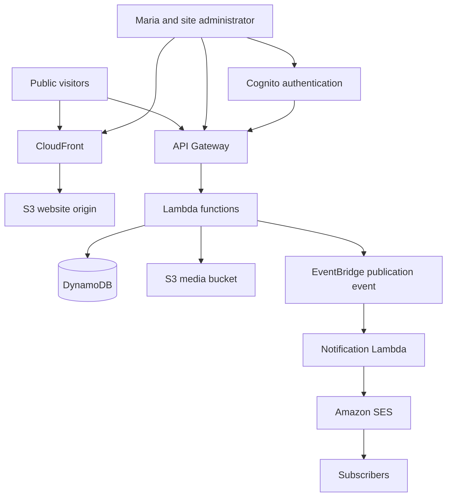

# Solution Architecture

## Architecture overview

The application is a serverless web platform with a public bilingual website and a protected author dashboard.

## Main components

| Component | Responsibility |
|---|---|
| Amazon S3 | Static website assets and private uploaded media |
| Amazon CloudFront | Global content delivery and HTTPS entry point |
| Amazon Cognito | Sign-in and identity tokens for administrators |
| Amazon API Gateway | HTTPS API for content, comments and subscriptions |
| AWS Lambda | Serverless application logic |
| Amazon DynamoDB | Work metadata, comments, subscriber records and audit metadata |
| Amazon SES | Confirmation, notification and moderation-related email |
| Amazon EventBridge | Decouple publication from email notification processing |
| Amazon CloudWatch | Logs, metrics and alarms |
| AWS Budgets | Cost monitoring and alerts |
| Route 53 | DNS, if the domain is hosted there |
| AWS Certificate Manager | TLS certificates |

## Region

Use `eu-west-2` (London) for regional application services unless a service constraint or cost/availability assessment indicates otherwise.

CloudFront is a global service. A certificate attached to a CloudFront distribution must be provisioned in `us-east-1` (N. Virginia), even when the origin and application services are in London.

## Website delivery

The public site and admin interface can initially be delivered as static assets through CloudFront. The S3 origin should not be directly public; use CloudFront Origin Access Control (OAC).

The browser calls API Gateway for dynamic operations. Public read operations expose published works only. Drafts and administrator operations require a valid Cognito token and backend authorisation.

## Authentication and authorisation

- Cognito User Pool authenticates Maria and the site administrator.
- Both accounts receive the `Administrators` group.
- Maria additionally receives the `CommentModerators` group.
- Lambda authorisation checks group membership and, where necessary, the authenticated Cognito subject.
- Never rely on frontend visibility or disabled buttons as the security boundary.

The initial implementation should use two named administrator accounts rather than public self-registration.

## Content and media

- Literary text and metadata live in DynamoDB.
- Portuguese and English versions are language fields/records linked by one stable work identifier.
- Original manuscript files may also be retained in version-controlled content files for archival purposes.
- Uploaded photographs are stored in S3. Store object keys and metadata in DynamoDB, not image binaries.
- Use pre-signed upload URLs so the browser can upload directly to S3 without receiving AWS credentials.

## Publishing and notifications

1. An administrator submits a work for publication.
2. The publish Lambda validates the content and permissions.
3. The work status changes to `published`.
4. The publishing operation emits a publication event to EventBridge.
5. A notification Lambda finds confirmed, active subscribers.
6. SES sends a notification containing the title, excerpt and link.

The notification process should be asynchronous, retry safely and avoid sending duplicate messages when events are delivered more than once. Store a notification/delivery record or idempotency key.

## Comments

- Public submissions are stored with status `pending`.
- Only authenticated members of `CommentModerators` may approve or reject.
- Maria is the only initial member of that group.
- Public read APIs return approved comments only.
- Apply input validation, output encoding, rate limiting and spam controls.

## Subscriptions

- Use double opt-in: an address is not active until its owner confirms.
- Store consent timestamp, confirmation status, status and unsubscribe timestamp.
- Confirmation and unsubscribe tokens must be unguessable, single-purpose and time-limited where appropriate.
- Do not expose subscriber lists through public APIs.
- Use SES configuration sets and domain authentication.

## Data model direction

Start with a small number of DynamoDB tables or a single-table design only if access patterns justify it. Prefer clear, understandable modelling for the first implementation. See `docs/database-design.md`.

## Cost and operational controls

- Use AWS Budgets alerts before provisioning.
- Keep development resources small.
- Avoid always-on compute.
- Set CloudWatch log retention periods.
- Configure S3 lifecycle policies where appropriate.
- Review SES sending limits and production access requirements.
- Estimate costs before enabling public traffic.

## Deployment

Initially deploy manually after learning the services. Later use Terraform for infrastructure and GitHub Actions for test/build/deploy workflows. Keep secrets out of Git and use GitHub Actions OIDC for AWS deployment rather than long-lived access keys.
